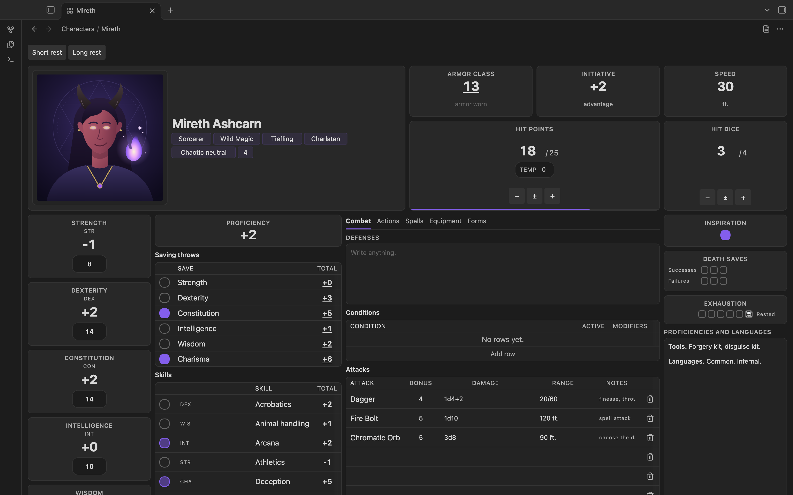
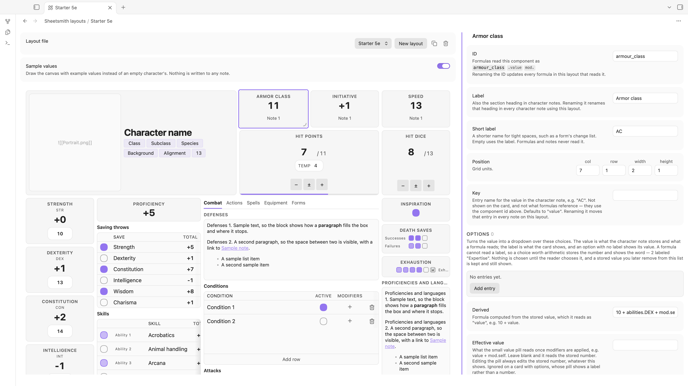
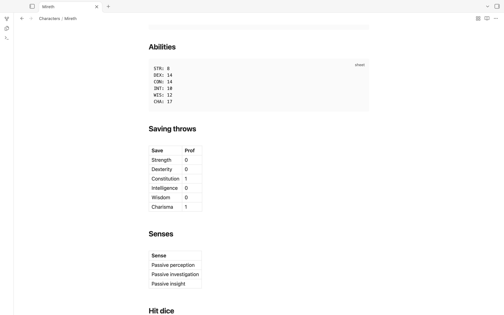
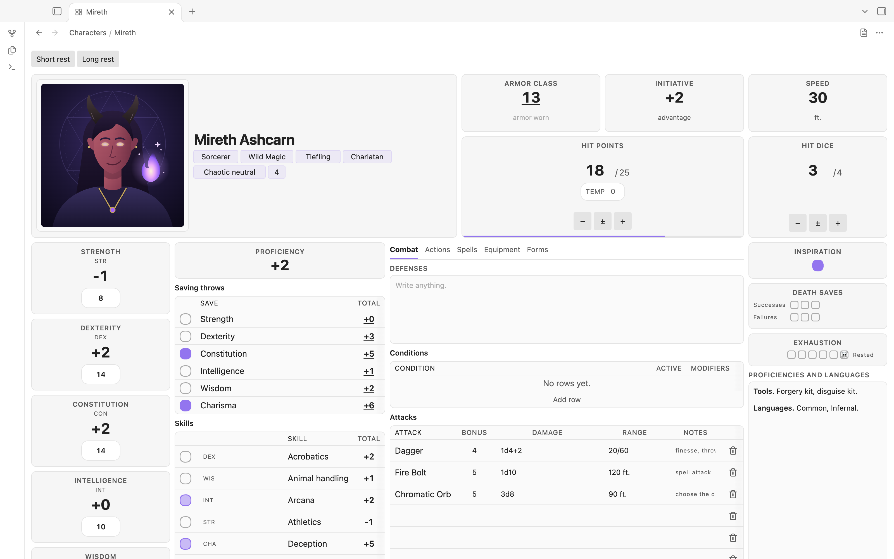

# Sheetsmith: a character sheet builder for Obsidian

Build interactive character sheets for any tabletop RPG in [Obsidian](https://obsidian.md). Lay out a sheet on a grid, write the formulas that connect its fields, and keep every character as a plain markdown note.

Sheetsmith knows arithmetic and nothing about any game. Every rule lives in the layout you build, so one plugin serves D&D 5e, Pathfinder 2e, Forged in the Dark games, Call of Cthulhu, or a system you wrote yourself. It ships with starter layouts for 5e, PF2e and Forged in the Dark.



## Features

- **Layout editor.** Place components on a grid and see the sheet with sample values as you build. Undo, copy and paste between layouts, and import or export a layout to share it.
- **Twelve components.** Cards, tables, trackers, resource pools, tabs, images, rich text and repeating records such as spells, inventory or class features.
- **Your own formulas.** Define functions per layout, such as `mod(score) = floor((score - 10) / 2)`, and let totals, rests and resets compute themselves.
- **Modifiers with sources.** Items, conditions and forms apply typed modifiers, and every value can show a breakdown of where it came from.
- **Plain markdown characters.** A character note holds one property and readable values. Wikilinks in a sheet are real links, so backlinks, graph view and renames work.
- **Queryable with Bases and Dataview.** Promote chosen values, such as level or AC, into a character's frontmatter.
- **Works on mobile.** Sheets and the layout editor run on phones and tablets.



## How it works

A character is a normal note. One property names its layout, and the values live in the body:

````markdown
---
sheet-layout: DnD 5e Caster
---

## Abilities
```sheet
STR: 8
DEX: 16
WIS: 12
```

## Inventory

| Item | Qty | Weight | Equipped |
|---|---|---|---|
| [[Bag of Holding]] | 1 | 15 | yes |
````



One layout serves many characters. A skill list needs one formula, not eighteen:

```
ability + Training * prof + Bonus
```

`Training` is a graded column (untrained, proficient, expertise), and each row names its ability, so the layout describes the system once.



## Install

Sheetsmith is in the [Obsidian community plugin list](https://community.obsidian.md/plugins/sheetsmith). It needs Obsidian 1.9.0 or newer.

1. In **Settings → Community plugins**, select **Browse**, search for **Sheetsmith**, and install it.
2. Select **Enable**.
3. Run **Sheetsmith: Add a starter layout** from the command palette.
4. Run **Sheetsmith: Create a character** and pick the layout.

Try it in a new vault first. The plugin rewrites note bodies, and the parser has little mileage outside the author's own vaults.

## Layout files

A layout is a `.sheetsmith` file in the layout folder (**Sheetsmith layouts** by default). It is plain JSON, and selecting it opens the layout editor. Layouts from earlier versions end in `.json`. Sheetsmith offers to convert them, so update the plugin on every device before converting.

Without the plugin, layout files stay hidden unless **Settings → Files and links → Detect all file extensions** is on.

<!-- HELD: the sentence on how Obsidian Sync treats .sheetsmith files goes here once the owner has observed it in the app (docs/features/visible-layout-files.md, Documentation). Not written from the docs. -->

## Styling

A [CSS snippet](https://help.obsidian.md/snippets) can tune a sheet through the `--sheetsmith-` custom properties on `body`. For example, `--sheetsmith-inline-control-factor` (default `1.6`, `2.2` on touch screens) resizes the small round controls:

```css
body {
	--sheetsmith-inline-control-factor: 1.8;
}
```

## Privacy

Sheetsmith makes no network requests and collects no data. Beyond the note or layout you have open, it reads:

- **Vault file names**, to suggest images in a picture field.
- **Notes' `sheet-layout` property**, to find the characters that use a layout when you rename a layout or a component.
- **The clipboard**, in the layout editor, when you copy or paste a component or a layout.

Prose fields use the deprecated `execCommand('insertText')` to auto-close brackets and continue lists, because it is the only write that keeps the field's undo history.

## Release notes

See the [releases page](https://github.com/Richie735/obsidian-sheetsmith/releases).

## License

[MIT](LICENSE)
